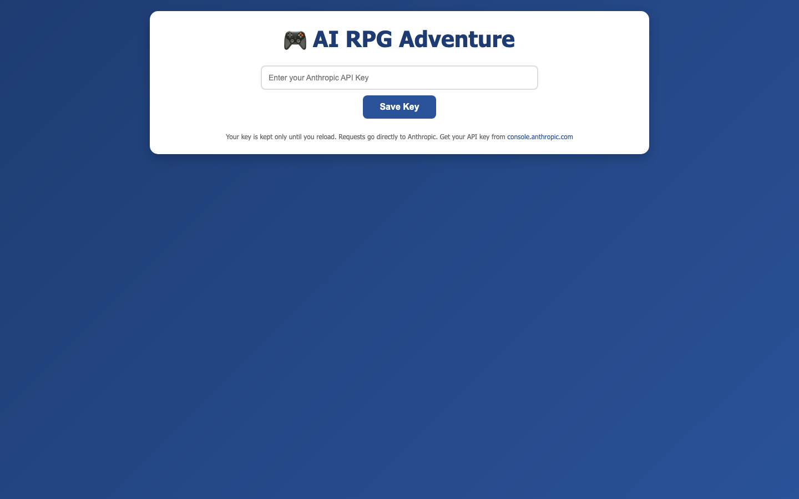

# AI RPG Adventure

[](https://unknown-x0.github.io/AI-RPG/)
[](https://developer.mozilla.org/en-US/docs/Web/JavaScript)
[](https://docs.anthropic.com/en/api/messages)

A small browser-based fantasy RPG. Claude acts as the dungeon master: describe what your character does, read the story response, and follow your health, attack, defense, and gold as the adventure unfolds.

**[Open AI RPG Adventure →](https://unknown-x0.github.io/AI-RPG/)**



## Features

- **Free-form actions:** type what your character does, or use the quick-action buttons.
- **Claude as dungeon master:** a fantasy adventure that responds to every turn.
- **Live stats:** health, attack, defense, and gold shown as you play.
- **Stat tags:** responses update stats with tags such as `[HEALTH: -15]` and `[GOLD: +25]`.
- **Choice of provider:** Claude by default, or Google Gemini, OpenRouter, or another OpenAI-compatible service, so a free-tier key works too.

## Getting started

### Use it online

Open the [live site](https://unknown-x0.github.io/AI-RPG/), choose a provider, and enter its API key on the start screen. Anthropic keys are paid per use; Google Gemini ([aistudio.google.com/apikey](https://aistudio.google.com/apikey)) and OpenRouter ([openrouter.ai/keys](https://openrouter.ai/keys), model `openrouter/free`) offer free tiers with rate limits. The model name and service address can be changed for any OpenAI-compatible service.

### Run it yourself

Clone the repository and serve the folder; there is no build step or package installation.

```sh
git clone https://github.com/UNKNOWN-X0/AI-RPG.git
cd AI-RPG
python3 -m http.server 8000 --bind 127.0.0.1
```

Then open `http://127.0.0.1:8000`, or use VS Code's Live Server extension.

## Privacy

The API key is kept in memory for the current page session and cleared when the page reloads; it is never stored. The browser sends your actions and the story so far directly to the provider you chose (Anthropic's Messages API, or the service's chat-completions endpoint), and nowhere else. Never publish your key or commit it to this repository.

## Development

### Customize

- Change the starting player stats and inventory in `js/state.js`.
- Edit the dungeon-master instructions in `js/setup.js`.
- Adjust the Claude model, the provider presets, and request settings in `js/api.js`.
- Add stat tags in `js/stats.js` and explain them in the prompt in `js/setup.js`.

## Tests

```sh
node --test tests/*.test.cjs
```

The tests load the scripts against a fake page and a stubbed API, and check setup, turns, stat tags, retries, and error handling without network access.

## Project structure

```text
index.html          Page structure and ordered script loading
styles.css          Layout and visual styles
js/state.js         Game state and player stats
js/dom.js           References to page elements
js/setup.js         Startup, key entry, and quick actions
js/adventure.js     Story requests, player turns, and loading state
js/api.js           Anthropic Messages API request
js/stats.js         Stat-tag parsing and display updates
js/ui.js            Story messages and page startup
tests/              Functionality tests (node --test)
assets/preview.png  Screenshot for this README
```

The JavaScript files are classic scripts that share one page scope. Keep their loading order in `index.html` when adding or moving a module.

## Project documents

| File | What it covers |
| --- | --- |
| [ROADMAP.md](ROADMAP.md) | What is planned next, with an issue per item |
